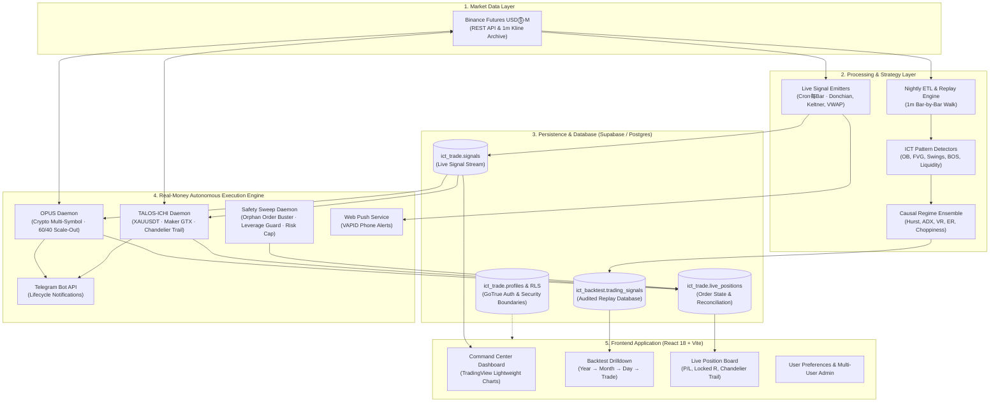

<div align="center">

# 🎯 PUSU — Liquidity Ambush Intelligence
### *Production Quantitative Trading System & Algorithmic Research Laboratory*

[](https://www.python.org/)
[](https://react.dev/)
[](https://vitejs.dev/)
[](https://supabase.com/)
[](https://www.binance.com/)
[](https://www.tradingview.com/)
[](https://github.com/huseyin-yigit-ulker/ict-trade)

<p align="center">
  <b>A battle-tested algorithmic trading platform bridging empirical microstructure research with real-money execution.</b><br>
  <i>1-minute tick/kline replay · Bit-identical no-lookahead verification · Out-of-sample regime stress testing · Real-money Binance Futures execution with exchange-side trailing stops and auto-leverage · Zero-knowledge RSA API key encryption · Multi-user React dashboard.</i>
</p>

[⚡ Live Book](#-the-live-book--production-systems) •
[🔬 Research Reports](#-quantitative-research-library--empirical-reports) •
[🏗️ Architecture](#️-system-architecture) •
[🛡️ Security](#-enterprise-security--multi-user-architecture) •
[📊 Performance](#-verified-track-record--performance) •
[🚀 Quickstart](#-quickstart--installation) •
[📚 Documentation](#-documentation-index)

</div>

---

## ⚡ Executive Summary

**PUSU** is a complete, full-stack quantitative trading pipeline designed, backtested, and deployed live to production. Rather than relying on naive technical indicators or backtest-curve-fitted marketing claims, this codebase is built around **empirical falsification**, **strict out-of-sample (OOS) testing**, and **execution cost reality**.

```
  ┌────────────────────────────────────────────────────────────────────────────────┐
  │  560+ Commits · 180+ Python Quantitative Engines · 40+ React Components        │
  │  20+ Strategies Tested · Rigid OOS Filter (Survivorship Bias Eliminated)       │
  │  2 Live Mainnet Executors (Crypto + Gold) · 1 Paper Benchmark · 0 Lookahead    │
  │  Multi-User Architecture · PostgreSQL Row-Level Security · RSA-4096 Encrypted  │
  └────────────────────────────────────────────────────────────────────────────────┘
```

### Key Engineering Pillars
1. **Cost-Aware Backtesting**: Every trade is resolved tick-by-tick on Binance 1-minute data with real taker/maker fee structures, exchange slippage, and limit order expiration windows (180m).
2. **Bit-Identical No-Lookahead Audits**: Signals generated on month-end truncated data must bit-identically match full-dataset runs ($0.00e+00$ variance). If an idea collapses out-of-sample, it is documented honestly as overfit—never disguised.
3. **Autonomous Mainnet Execution**: Dedicated state-machine daemon reconciling orders every 2 minutes with automated position tracking, margin auto-leverage, chandelier trailing stops, and safety sweeps.
4. **Enterprise Multi-User Security**: Complete GoTrue auth, PostgreSQL Row-Level Security (RLS) enforcement, RSA-4096 asymmetric encryption for user Binance API credentials, and exponential brute-force protection.

---

## 🟢 The Live Book — Production Systems

Three primary quantitative streams are surfaced live in the platform. Two manage **real capital on Binance Futures Mainnet**, while one is maintained as a paper benchmark due to exchange fee structure realities.

| Stream | Strategy Identifier | Underlying Asset | Execution Mode | Capital Risk | Verified Headline Performance |
|---|---|---|---|---|---|
| 🔴 **OPUS** | `d30so8f3h7` | Crypto Basket<br>*(BTC, ETH, SOL, FET, ARB)* | **REAL MONEY**<br>Binance Futures Mainnet | Auto-Leverage<br>$5–$15 / trade | **+388.6R** / 2,806 trades / **PF 1.29** / **WR 54.4%**<br>Consistent annual edge: 2024 (+45.8R), 2025 (+200.9R), 2026 (+141.9R) |
| 🔴 **TALOS-ICHI-X** | `talos_ichi` | Gold Perp<br>*(XAUUSDT 1m)* | **REAL MONEY**<br>Binance Futures Mainnet | Auto-Leverage<br>$3.00 / trade | **+118.3R** 3-Year OOS / **PF 1.34** / Chandelier 3.5×ATR trail<br>Ichimoku Kumo filter lifted performance from +35.6R → +118.3R |
| 🟡 **MIDAS-X** | `midas` | Gold Perp<br>*(XAUUSDT 1m)* | **PAPER / BENCHMARK**<br>Binance Testnet | Simulated $3 / trade | **+142.0R** settled (2026-H1) on FX/ECN cost model.<br>*Kept on paper because Binance taker fees degrade the edge.* |

> ### 💡 The Fee Reality Principle (Why MIDAS is Paper)
> Quantitative honesty is paramount in this repository. In backtesting on an FX/ECN cost structure (~$0.50/oz spread), **MIDAS** delivers a stellar **+142R (PF 1.48)**. However, when modeled with Binance crypto taker fees (~$4.00/oz roundtrip), net returns flip to **≈ −92R**. 
> Instead of ignoring fees or pretending the edge exists on crypto exchanges, **TALOS-ICHI-X** was developed with maker limit entries (GTX) and exchange-side trailing stops to conquer exchange fee drag, earning the real-money mainnet slot. See [MIDAS.md](MIDAS.md) for full audit.

---

## 🔬 Quantitative Research Library & Empirical Reports

This repository contains an exhaustive series of rigorous quantitative research papers documenting both surviving edges and instructive failures:

```
├── 📑 STRATEJI-RAPORU.md          # Strategy evolution: 20+ variants, in-sample vs OOS reality
├── 📑 ORDERFLOW-RAPORU.md         # Breakout bar aggressor delta imbalance (taker buy/sell)
├── 📑 FX-GOLD-VWAP-RAPORU.md      # Ground-up XAUUSDT microstructure, VWAP & Monte Carlo null tests
├── 📑 ML-XAU-RAPORU.md            # LightGBM triple-barrier meta-labeling & honest NO-SHIP decision
├── 📑 MIDAS.md                    # Gold execution engine, fee reality & state machine specification
├── 📑 RUNBOOK.md                  # Comprehensive operations manual, deployment & failover
├── 📑 PUSU-UX-RAPORU.md           # Terminal UI/UX audit, real-time risk controls & telemetry
├── 📑 ICT_Signal_Strategies.md    # ICT structural mechanics: FVG, Order Blocks, Liquidity Sweeps
└── 📑 SUPDEM-VIDEO-RED-RAPORU.md  # Video-assisted supply/demand pattern audit
```

### Highlights from the Research

#### 1. Out-of-Sample Regime Validation (`STRATEJI-RAPORU.md`)
- Over 20 strategies were tested across **2026 (In-Sample)** and **2025 (Out-of-Sample)**.
- In-sample, almost all strategies appeared profitable. Replaying on 2025's market regime destroyed naive trend-following models (`MAIN v1`: −245.4R, `IMPULSE v2`: −221.4R).
- **Core Insight**: The ICT structural setup is fundamentally a **range-bound mean-reversion engine**. Edge only exists in genuine range regimes. The surviving range book (`range`, `range_q`, `v2_light_r`) generated consistent positive return across all years.
- **Regime Ensemble Gate**: Implemented a 6-indicator causal consensus engine: Efficiency Ratio, ADX, Choppiness Index, Hurst Exponent, Variance Ratio, and Lag-1 Autocorrelation.

#### 2. Order Flow & Aggressor Delta Imbalance (`ORDERFLOW-RAPORU.md`)
- Dispels the myth that tick-level `aggTrades` archives (gigabytes of data) are necessary.
- Leverages Binance 1m/30m klines native `taker_buy_volume` to compute instantaneous aggressor imbalance:
  $$\Delta = \text{taker\_buy} - \text{taker\_sell} = 2 \cdot \text{taker\_buy} - \text{volume}$$
  $$\text{dr} = \frac{\Delta}{\text{volume}} \in [-1, +1]$$
- **Breakout Bar Delta Ratio**: Enforcing direction-aligned delta ($\text{dr} > 0.10$) eliminates 31% of trades while preserving 95% of cumulative R, boosting **avgR by +39%** and lifting Profit Factor from **1.29 to 1.41**.
- Validated via monotonicity ladders, walk-forward testing (threshold selected solely on 2024 data, tested untouched on 2025–2026), and a random-elimination Monte Carlo null test (**$z = +2.62$, 99.3rd percentile**).
- **Instructive Negative Finding**: Discovered that trailing CVD slopes (`agg12`, `agg24`) produced immaculate in-sample ladders but completely failed to generalize across alternative timeframes ($z = -0.65$), proving the importance of cross-strategy falsification.

#### 3. Machine Learning & Meta-Labeling (`ML-XAU-RAPORU.md`)
- Explored Lopez de Prado's Triple Barrier Method + LightGBM meta-labeling on Gold (XAUUSDT).
- Purged Group TimeSeriesSplit cross-validation achieved an AUC of **0.563** (vs shuffle null 0.511).
- **The Honest Verdict**: Despite learning a statistically significant signal, the ML model failed to outperform the simple, robust 1-parameter **AFTER-LOSS** execution gate already in production. In accordance with parsimony principles, the model was given a definitive **NO-SHIP** decision.

---

## 🏗️ System Architecture



---

## 🛡️ Enterprise Security & Multi-User Architecture

The system is designed with security-by-design principles:

```
                                  Client-Side Browser
                                           │
                        ┌──────────────────┴──────────────────┐
                        ▼                                     ▼
             RSA Public Key Encryption               GoTrue Session Token
             (User API Keys Encrypted)               (JWT with RLS Scope)
                        │                                     │
                        └──────────────────┬──────────────────┘
                                           ▼
                                Supabase PostgreSQL
                                 [Row-Level Security]
                                           │
                         (Only Server Has RSA Private Key)
                                           ▼
                              Automated Live Executors
```

1. **Zero-Knowledge API Key Storage**: When users connect their Binance API credentials via the dashboard, keys are encrypted in-browser using **RSA-4096 asymmetric encryption** (`scripts/gen_exec_keypair.py`). Only the background execution daemon on the private server holds the private key required for decryption.
2. **PostgreSQL Row-Level Security (RLS)**: Database tables enforce strict RLS policies. Users can only query their own trades, positions, and settings. Admin features are protected by role-gated database triggers.
3. **Hardened Static Frontend**: The React frontend connects via Supabase publishable keys with zero server-side secret exposure (`vite.config.js` strictly filters environment variables).
4. **Brute-Force & Lockout Controls**: Client-side persistent exponential backoff (5 failed attempts trigger a 30s lock, doubling up to 15 minutes) coupled with server-side rate-limiting.
5. **Fail-Closed Execution Architecture**: All automated executors default to dry-run mode (`EXEC_DRY_RUN=true`, `LIVE_TRADING_ENABLED=false`). Any API discrepancy, clock drift, or margin failure automatically halts trading and notifies operators via Telegram.

---

## 📊 Verified Track Record & Performance

### 1. OPUS Strategy (`d30so8f3h7`) — Crypto Basket
*Donchian 30m Breakout + 4h Confirmation + Scale-Out Exit (60% at +1R, runner to 8R cap / BE stop / 7-day timeout)*

```
Period            Trades     Win Rate     Profit Factor     Net Return (R)
──────────────────────────────────────────────────────────────────────────
2024 (OOS-1)         842        53.2%              1.22            +45.8 R
2025 (OOS-2)       1,124        55.1%              1.33           +200.9 R
2026 (Live/IS)       840        54.6%              1.30           +141.9 R
──────────────────────────────────────────────────────────────────────────
Total Cumulative   2,806        54.4%              1.29           +388.6 R
```

### 2. TALOS-ICHI-X Strategy (`talos_ichi`) — Gold (XAUUSDT 1m)
*Keltner Band Pullback + Ichimoku Kumo Filter + 3.5×ATR Chandelier Trailing Stop*

```
Metric                             TALOS Baseline              TALOS-ICHI (Current Live)
─────────────────────────────────────────────────────────────────────────────────────────
3-Year Net PnL (R)                        +35.6 R                               +118.3 R
Profit Factor                                1.12                                   1.34
Win Rate                                    42.1%                                  47.8%
Fee Resilience                             Medium                     High (Maker Limit)
Trailing Stop                     Exchange Trailing               Chandelier 3.5×ATR Stop
```

---

## 🧰 Technology Stack

| Domain | Technology | Details |
|---|---|---|
| **Quantitative Backend** | Python 3.10+ | `pandas`, `numpy`, `scipy`, `numba`, `lightgbm`, `statsmodels` |
| **Market Data & Execution** | Binance REST API | Custom signed REST client with auto clock-drift sync, HMAC-SHA256 |
| **Database & Auth** | Supabase (PostgreSQL 15) | Schema migrations, Row-Level Security (RLS), GoTrue Auth |
| **Frontend Platform** | React 18, Vite | Vanilla CSS design system, Context API, responsive mobile-first UI |
| **Data Visualization** | TradingView Lightweight Charts | Custom canvas overlays, multi-timeframe candle sync, trade markers |
| **Notifications** | Telegram Bot API & Web Push | Instant execution notifications, daily R logs, VAPID Web Push |
| **Infrastructure** | Oracle Cloud Infrastructure | Always-Free Ubuntu VM deployed in Frankfurt/Amsterdam (EU egress) |

---

## 🚀 Quickstart & Installation

### 1. Prerequisites
- Node.js 18+ & npm
- Python 3.10+ & `venv`
- Supabase project (or PostgreSQL instance)
- Binance Futures account (Testnet or Mainnet)

### 2. Frontend Dashboard Setup
```bash
# Clone the repository
git clone https://github.com/huseyin-yigit-ulker/ict-trade.git
cd ict-trade

# Install JavaScript dependencies
npm install

# Configure environment variables
cp .env.example .env
# Edit .env to set VITE_SUPABASE_URL and VITE_SUPABASE_PUBLISHABLE_DEFAULT_KEY

# Start the development server
npm run dev
# The application will launch at http://localhost:5173
```

### 3. Backend & Strategy Engine Setup
```bash
# Set up Python virtual environment
python3 -m venv .venv
source .venv/bin/activate

# Install dependencies
pip install -r requirements.txt

# Run backtest for OPUS on Bitcoin
python backtest/run_backtest.py --symbol BTCUSDT --interval 30m --days 90

# Emit live market signals (Dry-Run)
python sync/donchian/canli.py --stream all
```

### 4. Cloud Deployment (Oracle Cloud Always-Free VM)
To prevent geo-blocking issues (Binance HTTP 451 from US IP addresses), the system is designed to run in an EU Oracle Cloud region:
```bash
# On your remote EU Ubuntu instance:
git clone https://github.com/huseyin-yigit-ulker/ict-trade.git
cd ict-trade
bash dag/setup_vm.sh
```
Follow the step-by-step production runbook in **[RUNBOOK.md](RUNBOOK.md)** and **[dag/DEPLOY_ORACLE.md](dag/DEPLOY_ORACLE.md)**.

---

## 📚 Documentation Index

| Resource | Scope and Purpose |
|---|---|
| 📖 **[RUNBOOK.md](RUNBOOK.md)** | Production operations guide, system architecture, cron schedules, and failover runbook. |
| 📖 **[MIDAS.md](MIDAS.md)** | Full specification of the gold quantitative engine, state machine, and fee audit. |
| 📖 **[STRATEJI-RAPORU.md](STRATEJI-RAPORU.md)** | Strategy autopsy report: 20+ tested models, OOS performance, and regime gating. |
| 📖 **[ORDERFLOW-RAPORU.md](ORDERFLOW-RAPORU.md)** | Aggressor delta ratio study on breakout bars, walk-forward validation ($z = +2.62$). |
| 📖 **[FX-GOLD-VWAP-RAPORU.md](FX-GOLD-VWAP-RAPORU.md)** | Ground-up gold research, VWAP-trend pullbacks, and Monte Carlo null simulations. |
| 📖 **[ML-XAU-RAPORU.md](ML-XAU-RAPORU.md)** | Triple-barrier machine learning meta-labeling analysis and parsimony assessment. |
| 📖 **[ICT_Signal_Strategies.md](ICT_Signal_Strategies.md)** | Structural market theory: Fair Value Gaps (FVG), Order Blocks, and Liquidity Pools. |
| 📖 **[dag/DEPLOY_ORACLE.md](dag/DEPLOY_ORACLE.md)** | Autonomous VM provisioning, EU region networking, and cron daemon setup. |

---

## 📂 Repository Directory Structure

```
ict-trade/
├── backtest/                 # Walk-forward backtest engines and lookahead verification
│   ├── ict/                  # Structural ICT pattern detectors (FVG, OB, BOS, Liquidity)
│   ├── validation/           # Bit-identical truncation audits and parity verifiers
│   └── run_backtest.py       # Backtest execution CLI
├── dag/                      # Production scheduling, Airflow DAGs, and VM deployment
│   ├── dag.py                # Standalone hourly scanner and signal pipeline
│   ├── DEPLOY_ORACLE.md      # Cloud VM infrastructure guide
│   └── setup_vm.sh           # Automated idempotent setup script
├── src/                      # React 18 + Vite frontend terminal
│   ├── components/           # Modular UI widgets, TradingView chart modals, cards
│   ├── context/              # AuthContext (GoTrue), TradeContext, Theme & Language
│   ├── pages/                # LivePositions, CommandCenter, BacktestDrilldown, Admin
│   └── utils/                # Crypto math, stream stats, Supabase client, Gotrue
├── supabase/                 # Database migrations and security policies
│   └── migrations/           # 20+ SQL migrations defining tables, RLS, profiles & triggers
├── sync/                     # Live signal emission & automated execution engines
│   ├── donchian/             # OPUS Donchian strategy implementation & live emitter
│   ├── live_exec/            # Production OPUS crypto executor daemon
│   ├── talos_ichi_exec/      # Production TALOS-ICHI gold executor daemon
│   ├── midas_exec/           # MIDAS paper executor benchmark
│   └── sync_daily.py         # Daily database synchronization and PnL resolution
├── .env.example              # Sanitized environment variable template
├── symbols.json              # Canonical asset portfolio configuration
└── package.json              # Frontend manifest and build scripts
```

---

## ⚠️ Disclaimer & Risk Notice

> **IMPORTANT DISCLAIMER**: This software is built for educational, quantitative research, and personal algorithmic trading purposes. Algorithmic trading and trading cryptocurrency or financial derivatives carries substantial risk of financial loss. Past performance, backtest metrics, and out-of-sample evaluations are not guarantees of future performance. Never risk money you cannot afford to lose. The authors and contributors assume no responsibility for any financial losses incurred through the use of this software.

---

<div align="center">
  <sub>Developed with quantitative rigor by <b>Hüseyin Yiğit Ülker</b> · 2026</sub>
</div>
