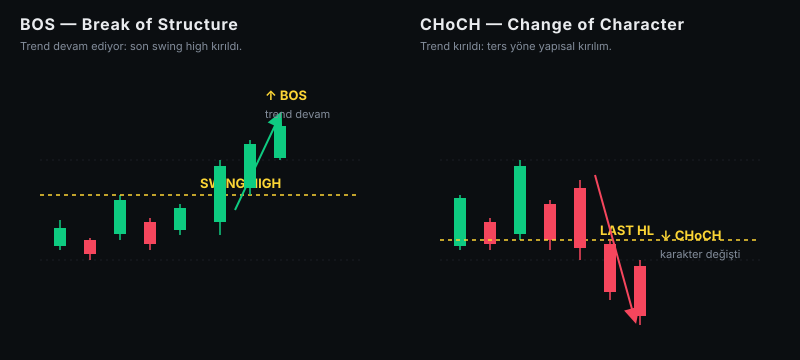
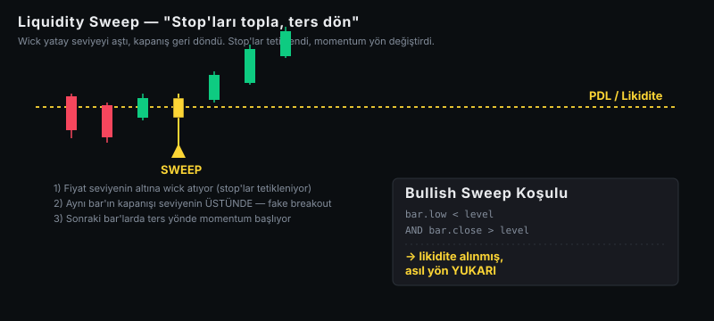
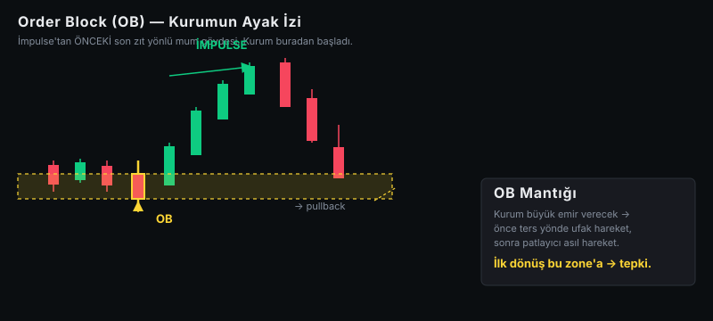
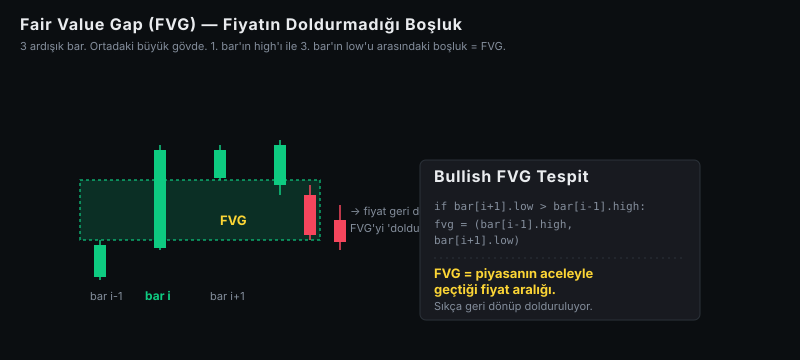
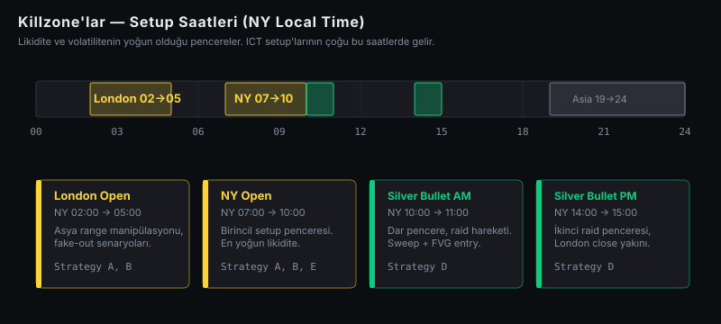
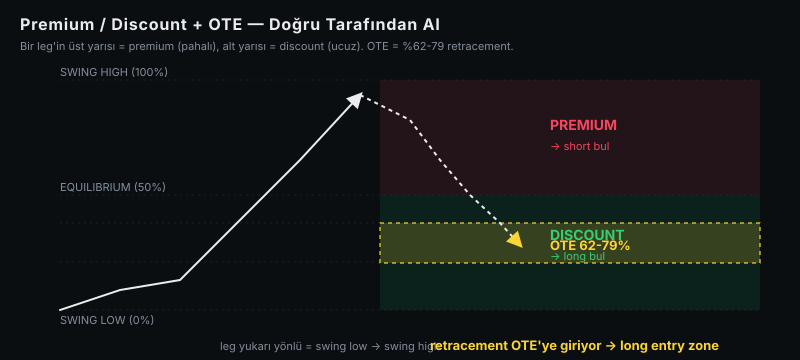

# ICT Trading 101: Kurumlar Senin Stop'ını Nasıl Topluyor?

*Smart Money Concepts'in işin mutfağına bakan kısmı. Bir bot tasarlayıp 5 yıllık veriyle test etmiş biri olarak yazıyorum.*

---

> **Bu yazı 6 yazılık serinin ilki.** Burada teorik kavramları anlatacağım — FVG, OB, sweep, killzone gibi. Sonraki yazılarda 5 stratejinin koddaki implementasyonu, 21,000+ sinyalin backtest sonuçları, ve "bu strateji gerçekten para kazandırır mı?" sorusunun dürüst cevabı var.

---

## "ICT" diye duydun, gözün korktu

Eğer trading'e bulaştıysan, muhtemelen bir yerlerde "ICT" lafını duydun. **Inner Circle Trader.** Forum köşelerinde, YouTube'da, Discord kanallarında, sözlü olarak. Bazıları kutsal kase gibi sunuyor, bazıları snake oil diyor.

Ben ne kutsal kase ne de snake oil diyeceğim. Sadece **bu adamlar gerçekte neye bakıyor** kısmını anlatacağım. Kod gözüyle, çalışan bir bot kurmuş ve veri üzerinde sınamış biri olarak.

ICT'nin **çekirdek iddiası** çok basit aslında:

> Piyasada iki taraf var: bilgili para (kurumlar, banka, whale) ve dağınık para (retail). Bilgili para; dağınık paranın stop'larını avlayıp, kendi büyük emrini bunun üzerine kuruyor.

Hepsi bu. Geri kalan her şey — FVG, OB, sweep, BOS — bu ana fikrin grafikte nasıl görüneceğine dair işaretçiler.

Şimdi bu işaretçileri tek tek tanıyalım.

---

## Yapı taşı 1: Swing High ve Swing Low

En basit kavramla başlayalım.

Bir mum, hem solundaki **3 mumdan** hem sağındaki **3 mumdan** daha yüksek tepe yapıyorsa = **swing high**. Tersi de **swing low**. Yani bariz, gözle ayırt edilebilen tepe ve dipler.

Önemli detay: bir swing point ancak `N` bar GEÇTİKTEN sonra "doğrulanır" (`confirmed_at`). Real-time'da gördüğün anki swing, henüz aday — gerçek swing demek için sağdan da yeterince bar gelmesi lazım.

Bu detay kodlarken hayati. Çünkü gelecekteki bar'a bakarak swing tespit etmek = backtest'te hile (look-ahead bias). Bizim engine bunu sıkı şekilde önlüyor — sonraki yazıda anlatacağım.

---

## Yapı taşı 2: BOS ve CHoCH



Trend devam mı ediyor, yoksa kırıldı mı? Bunu söylemenin iki kavramı var:

**BOS (Break of Structure):** Trend yönünde son swing high/low'un kapanışla aşılması. "Hala trend devam ediyor" sinyali.

- Yukarı trend → kapanış son swing high'ın üzerinde → BOS bullish
- Aşağı trend → kapanış son swing low'un altında → BOS bearish

**CHoCH (Change of Character):** Trende **ters** yönde ilk yapısal kırılma. "Trend yön değiştiriyor olabilir" sinyali.

- Yukarı trend → kapanış son **higher low**'un altında → CHoCH bearish
- Aşağı trend → kapanış son **lower high**'ın üstünde → CHoCH bullish

İlk CHoCH, trend yönü hakkında ipucu. Sonraki BOS'lar yeni yönü teyit ediyor. Bot mantığında bu iki olay zinciri "trend yönü"nü belirliyor.

---

## Yapı taşı 3: Likidite (yani retail trader'ın stop'ları)

Bu işin kalbi.

**Retail trader stop'ı nereye koyar?** Bariz bir tepe veya dibin **hemen üstüne/altına**. Çünkü teknik analiz kitabı öyle yazıyor: "destek/dirence yakın stop koy, küçük risk."

Sonuç: piyasada **sürekli yenilenen, tahmin edilebilir stop yığınları** var. Kurum büyük emir gerçekleştirecek mi? O stop yığınını AVLAR — fiyatı oraya çekip, aniden tetikler, sonra asıl yöne döner.

Bizim engine 6 tip likidite havuzu izliyor:

| Tip | Anlamı | Nasıl Oluşur |
|---|---|---|
| **PDH** | Previous Day High | Dünün en yüksek seviyesi |
| **PDL** | Previous Day Low | Dünün en düşük seviyesi |
| **PWH** | Previous Week High | Geçen haftanın tepesi |
| **PWL** | Previous Week Low | Geçen haftanın dibi |
| **EQH** | Equal Highs | İki swing high tolerans içinde aynı seviye → "çift tepe" |
| **EQL** | Equal Lows | İki swing low aynı seviye → "çift dip" |

Bu seviyeler havuzları işaretliyor. Asıl olay şuradan başlıyor: **sweep**.

---

## Yapı taşı 4: Sweep — Asıl drama



Sweep nedir?

> **Wick** seviyenin öbür tarafına geçti, **kapanış** geri döndü. Stop'lar tetiklendi, ama gerçek momentum o tarafta DEĞİL.

Bullish sweep matematiği şu kadar basit:

```
bar.low  < seviye    AND    bar.close > seviye
```

Yani fiyat aşağı süpürdü (likiditeyi aldı), kapanışta üstte. **Fake breakout**. ICT'de bu, "smart money'nin retail stop'larını topladığı an" olarak yorumlanıyor.

Aksi de geçerli (bearish sweep): wick yukarıyı aştı, kapanış altta.

Bizim botta sweep gözlemlendiğinde **iki şey** oluyor:
1. Ayrı bir CHoCH var mı? (yapısal teyit)
2. Sweep barından sonra impulse bar var mı? (ters yön momentum başladı mı?)

Eğer ikisi de varsa → setup adayı.

---

## Yapı taşı 5: Order Block (OB) — Kurumun Ayak İzi



OB = **bir impulse hareketinden hemen önceki son zıt yönlü mum**.

Kurum büyük bir long emri verecek. Önce ne yapar? Genelde ufak bir aşağı hareket — likiditeyi temizler, fiyatı uygun zone'a çeker. Sonra patlayıcı yukarı hareket başlar.

İşte o "ufak aşağı hareketin son kırmızı mumu" = bullish OB. Kurum buradan başladı.

Pratikte fiyat genelde bu zone'a geri döner ve tepki verir. ICT trader bunu entry zone olarak kullanır.

**İmpulse tanımı** (bizim engine):
- Ardışık 3+ aynı yönlü mum **VEYA**
- N bar içinde ≥ 2×ATR hareket

İmpulse'tan önceki son ters mumun **gövdesi** OB olarak işaretleniyor. Body çünkü daha disiplinli — tüm fitili almak gürültüyü artırıyor.

**Önemli**: OB ancak **mitigate edilmediği** sürece geçerli. Yani fiyat oraya geri dönüp temas ettiyse, kurum o emri "kullandı" sayılıyor; aynı zone bir daha aynı tepkiyi vermez.

Kodda mitigation şu mantıkla işaretleniyor: önce fiyat OB'den **uzaklaşmalı** (en az body kadar), sonra geri dönerse mitigation. Bu yapı bug'ı önemli — yoksa OB oluştuğu bar bile mitigated sayılıyor (impulse ilk barı OB top'una değer çünkü).

---

## Yapı taşı 6: Fair Value Gap (FVG) — Boşluğun psikolojisi



Üç ardışık bar düşün:

- 1. bar (i-1): normal
- 2. bar (i): **dev gövde**, hızlı hareket
- 3. bar (i+1): normal

Dev bar o kadar büyük ki, **1. barın yüksekliği** ile **3. barın düşüklüğü** arasında bir **boşluk** kalıyor. Yani fiyat o ARALIĞI atlamış — orada işlem olmamış.

Bu boşluğun adı **FVG (Fair Value Gap)** veya **imbalance**.

Bullish FVG matematiği:

```python
if bar[i+1].low > bar[i-1].high:
    fvg = (bar[i-1].high, bar[i+1].low)  # alt sınır, üst sınır
```

ICT'nin iddiası: piyasa "verimsiz" hareket etmekten hoşlanmaz, fiyat **genelde geri dönüp** o boşluğa girer ve doldurur. Yani FVG bir mıknatıs.

Fiyat FVG'ye geri döndüğünde reaksiyon olasılığı yüksek → entry zone.

**Doluş takibi:**
- Aralığın bir kısmına girerse → "partial fill"
- Karşı kenarı geçerse → "filled" (FVG değerini kaybetti)

Bizim engine `partial_at_index` ve `filled_at_index`'i kayıt altında tutuyor — strateji bir FVG'yi sorgularken `filled_at_index > current_bar` mı diye bakıyor (bu look-ahead'i önlemek için kritik).

---

## Yapı taşı 7: Killzone — Setup'ların geldiği saatler



ICT, günün **belli saatlerinde** likidite ve volatilitenin yoğunlaştığını söylüyor. Bu pencerelerde setup'lar geliyor; dışında çoğunlukla yan piyasa.

Saatler **NY local time**'a göre:

| Killzone | NY Saat | Notlar |
|---|---|---|
| Asia Range | 19:00–24:00 | Birikme/sıkıştırma — setup bekleme |
| London Open | 02:00–05:00 | Manipülasyon penceresi (Asya range break) |
| **NY Open** | 07:00–10:00 | **Birincil setup penceresi** |
| Silver Bullet AM | 10:00–11:00 | Dar pencere, raid hareketleri |
| London Close | 10:00–12:00 | İkincil setup, reversal |
| **Silver Bullet PM** | 14:00–15:00 | **İkinci raid penceresi** |

Strateji-D (Silver Bullet) sadece bu iki dar penceredeki FVG'lerde tetikleniyor. Diğer stratejiler London/NY Open'a açık. Killzone dışı saatlerde bot uyuyor.

(NY = America/New_York. Türkiye'den UTC+3'sün, NY UTC-5/-4. Yani NY 10:00 = TR 17:00 yazın, 18:00 kışın.)

---

## Yapı taşı 8: Premium / Discount + OTE



Bir leg'in (büyük bir hareketin) üst yarısı = **premium** (pahalı), alt yarısı = **discount** (ucuz). Orta nokta = **equilibrium**.

Mantık çok basit ama disiplin gerektiriyor:
- **Long entry'leri SADECE discount tarafında al.** (Pahalıdan alma!)
- **Short entry'leri SADECE premium tarafında al.**

**OTE (Optimal Trade Entry)**, leg'in **%62-79 retracement** bandı. Yani fiyat geri çekildiğinde bu daracık dilime girerse, yüksek olasılıklı entry. Bizim engine OTE içindeki entry'leri "high quality" olarak işaretliyor.

Pratik: bullish bir leg sweep ile başladıysa, leg'in low'u sweep extreme'i, high'ı son CHoCH bar'ı oluyor. OTE bu iki sınırın 62-79% retracement bandı.

---

## Hepsini birleştirmek: Confluence

Tek başına FVG ile trade etmek = düşük edge.
Tek başına OB = düşük edge.
Tek başına sweep = düşük edge.

Ama şöyle bir senaryo düşün:

1. **HTF (4H) trend** yukarı yönlü (BOS dizisi var)
2. Bir **likidite seviyesi** (PDL) sweep edildi
3. **LTF'de ters yön CHoCH** oluştu (yapısal teyit)
4. Sweep + CHoCH arasındaki impulse bir **OB** ve **FVG** üretti
5. Bu OB+FVG çakışma zone'unun midpoint'i tam **OTE bölgesinde**
6. Hepsi bir **killzone içinde** (NY Open mesela)

Bu birden fazla bağımsız sinyalin **aynı yere işaret etmesi** = **confluence**. ICT'nin altın madeni.

Bizim engine bunu **score sistemi**yle ölçüyor. Her faktör için puan:

```
HTF aligned       3
liquidity_swept   2
ltf_choch         2
ob_fvg_overlap    2
silver_bullet     2
power_of_three    2
discount_premium  1
ote_zone          1
in_killzone       1
multi_strategy    3
```

Sinyal yayımlanması için **toplam ≥ 6** (medium quality). **≥ 9** ise "high quality" (⭐). Birden fazla strateji aynı yönde tetiklerse "composite" olup +3 puan kazanıyor.

Bu skor, bir nevi "sinyal ne kadar güzel hazırlanmış" göstergesi. Backtest sonuçlarında high-quality sinyallerin kazanma oranı medium'lardan ~%4 daha yüksek çıktı (bir sonraki yazıda detaylar).

---

## Peki gerçekten kâr getiriyor mu?

Bunu sonraki yazıya saklıyorum. Tek söyleyeceğim: **5 yıllık veride 21,000+ sinyal** ürettim, **+497 R** toplam kâr çıktı. Ama yıllar arasında DRAMATİK farklar var:

- **2022**: −43 R (kayıp)
- **2023**: −62 R (kayıp)
- **2024**: +88 R
- **2025**: +111 R
- **2026 (5 ay)**: +402 R 🚀

Yani strateji **rejim duyarlı**. Trending piyasada parıldıyor, range piyasada zarar ediyor. Bu da ayrı bir yazının konusu — bir botun ne zaman aktif, ne zaman uyutulması gerektiğini konuşacağım.

---

## Sonraki yazılarda

1. **Bu yazı** — Teorik kavramlar (FVG, OB, sweep, BOS/CHoCH...)
2. **2. yazı** — 5 stratejinin (A-E) detaylı anatomisi
3. **3. yazı** — Detector'ları kodla yazmak (Python + pandas)
4. **4. yazı** — Look-ahead bias: backtest'te en sık yapılan hata, nasıl önlüyoruz
5. **5. yazı** — 5 yıllık backtest sonuçları + dürüst analiz
6. **6. yazı** — Bot'u live'a almak: Airflow + Telegram + Supabase

---

## Kapanış

ICT yöntemleri "smart money konseptleri" diyor. Akademik literatürde ispatlı pozitif edge'i yok — kabul edelim, bu mistik bir şey değil, bir **hipotezler kümesi**. Ama:

- Hipotezler **ölçülebilir** (tam olarak ne sayıyoruz, ne ile karşılaştırıyoruz, belli)
- Stratejiler **deterministik** (aynı veri → aynı sinyal)
- Backtest **dürüst yapılırsa** (look-ahead'siz) sonuçları **inkar edilemez**

Eğer trading öğreniyorsan ve bu kavramları yeni duyduysan, şu anki konfor zonun bunlar:
- "FVG, OB, sweep" artık jargon değil — neye baktığını anlıyorsun
- Bir backtest gördüğünde "ne soracağını" biliyorsun (look-ahead var mı? hangi yıl? hangi sembol?)
- Konusuna kavramsal olarak hâkimsin

Bot'a gerek yok. Manuel trade için bile bu kavramları görsel olarak okuyabiliyor olman büyük edge.

Sonraki yazıda **kod** gelecek. 5 stratejinin matematiksel ifadesi, neden A net kayıp da B-C-D-E pozitif gibi, bunları konuşacağız.

---

*Bu yazı için tüm kod açık kaynak: [github.com/huseyin-yigit-ulker/ict-trade](https://github.com/huseyin-yigit-ulker/ict-trade). Backtest framework, live runner, dashboard — hepsi orada. Issue açmaktan, PR atmaktan çekinme.*
